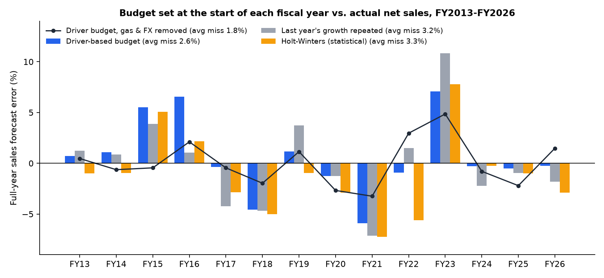
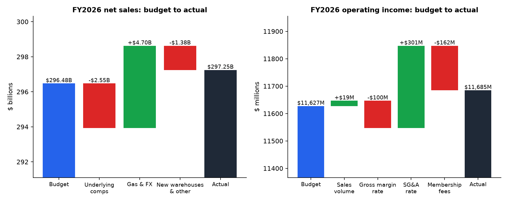
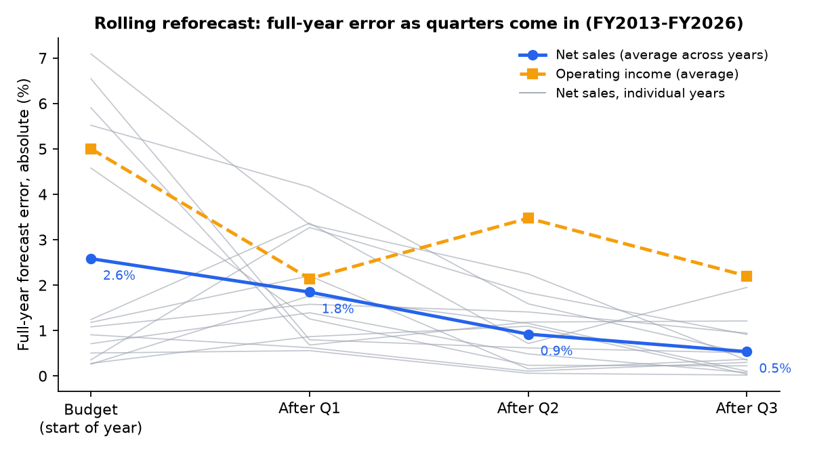
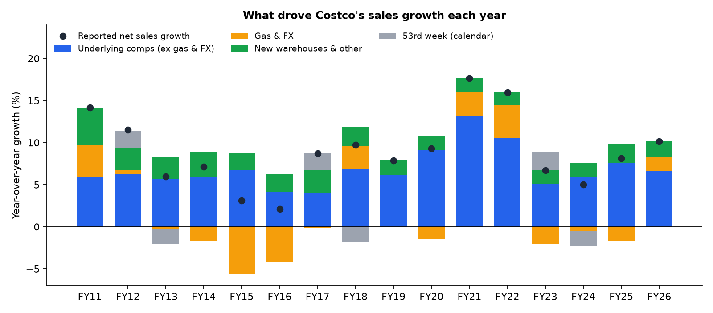
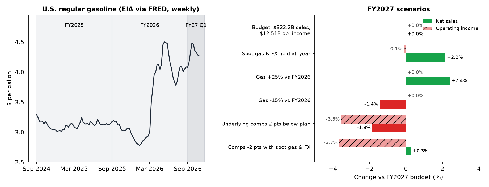

# Costco FY2027 forecast and budget-vs-actual model

FP&A teams build an annual budget, compare actual results with it each quarter, explain the gaps,
and reforecast the rest of the year. This project does that full cycle on a real company using only
public data. It covers Costco's last 14 fiscal years and then sets a live budget for fiscal 2027,
which started on Aug 31, 2026. Costco's first-quarter results are due in mid-December 2026, so the
model can be checked against real numbers soon.

The model is driver-based and uses the same terms Costco uses in its reports: comparable sales
excluding gasoline and foreign exchange, new warehouses, gas and FX effects, gross margin, SG&A, and
membership fees.

**Tools used:** Python (pandas, statsmodels, matplotlib, lxml), SEC EDGAR, FRED, and an Excel model
built with openpyxl. Every cell in the Excel plan is a formula, and LibreOffice recalculation was
used to confirm that Excel matches Python.

## Key findings

**1. FY2026 landed on budget, but for the wrong reasons.**
A budget set at the start of FY2026 from FY2025 data called for $296.5B in net sales. Actual sales
were $297.2B, a miss of just 0.3%. The bridge shows that the small miss hides two large offsetting
gaps. Underlying comparable sales grew 6.6% instead of the 7.5% planned, which left sales **$2.5B
short**. Higher gasoline prices from March 2026 onward added **$4.7B** that the budget held at zero
by design. A budget review that looked only at the total would have missed the slowdown.

Operating income was $11,685M against a $11,627M budget (+0.5%). The bridge:

| Driver | Effect ($M) |
|---|---|
| Budget | 11,627 |
| Sales volume | +19 |
| Gross margin rate | −100 (includes about +84 of one-time IEEPA tariff refunds in Q4) |
| SG&A rate | +301 |
| Membership fees | −162 (the September 2024 fee increase finished lapping) |
| **Actual** | **11,685** |

Both bridges close to exactly zero in every quarter, in Python and in the Excel formulas.

**2. The budget method beats simple and statistical baselines, and most of its miss is gas and FX.**
The same method, run as a budget at the start of each fiscal year from FY2013 to FY2026 using only
data available at the time, gave these results:

| Method | Average full-year sales miss | Years within 2% |
|---|---|---|
| Driver-based budget (this model) | **2.6%** | **9 of 14** |
| Last year's growth repeated | 3.2% | 7 of 14 |
| Holt-Winters exponential smoothing (statistical) | 3.3% | 5 of 14 |
| Last year's sales, no growth | 7.7% | 0 of 14 |
| Driver budget, gas and FX effect removed | 1.8% | 8 of 14 |

Gas and FX are the largest single source of miss. That is why the budget holds them at zero and
reports them as a separate bridge line, so the team is judged on what it controls. Operating income
is harder to forecast: the budget missed full-year operating income by 5.0% on average (4.2%
excluding FY2020–2022, the pandemic and inflation years).

**3. Reforecasting during the year cuts the sales error to under 1% by midyear.**
Updating the drivers after each quarter cut the average full-year sales error from 2.6% to 1.8%
after Q1, 0.9% after Q2, and 0.5% after Q3. Operating income did not improve as steadily: 5.0%,
2.1%, 3.5%, then 2.2%. Margin rates do not move in a straight line, so they need judgment rather
than mechanical extrapolation.

**4. FY2027 budget: $322.2B in net sales (+8.4%) and $12.51B in operating income (+7.1%).**
Drivers: 6.6% underlying comps (the FY2026 rate), 1.8% from new warehouses, membership fees growing
at the latest quarter's 7.3% run-rate, and FY2026 margin rates with the one-time tariff refund
removed. Costco plans to end FY2027 with 967 warehouses, up from 939. That is 3.0% unit growth,
consistent with the planned new-warehouse contribution.

**5. Gasoline is the swing factor to watch in FY2027 reporting.**
U.S. regular gasoline averaged $4.31 a gallon in the four weeks to Oct 26, 2026. That is 39% above
the FY2026 Q1 average and 50% above Q2. A model fit on 68 quarters explains 95% of Costco's gas/FX
effect on comps (about 0.1 points of comps for every 1% change in gas prices). If gas stays where it
is, reported FY2027 sales would run about **$7.0B (2.2%) above budget**, mostly in the first half,
with almost no gain in operating income, because fuel earns cents per gallon. A slowdown in
underlying comps matters far more for profit: 2 points slower would cost about **$440M of operating
income (−3.5%)**. Sales would fall and SG&A would deleverage by about 5 basis points per point of
comps. Strong reported sales in Q1 and Q2 should not be read as strong underlying demand.







## The Excel model

[`excel/costco_fy2027_plan_and_bva.xlsx`](excel/costco_fy2027_plan_and_bva.xlsx)

| Sheet | Contents |
|---|---|
| Inputs | FY2027 drivers by quarter. Blue cells are inputs. Two switches: an underlying comp shift and gas and FX at today's levels. |
| Plan_FY2027 | Quarterly P&L with every cell a formula on Inputs |
| BvA_FY2026 | Budget vs actual with sales and operating-income bridges and a zero-check row |
| Scenarios | Gas, FX, and comp scenarios |
| Backtest | Accuracy of the budget method and baselines, FY2013–FY2026 |
| Actuals | 68 quarters of P&L and comparable-sales drivers, FY2010–FY2026 |

When the Q1 FY2027 results come out, the next step is to add the actuals to a BvA_FY2027 sheet
using the same bridge formulas.

## Limitations

- **Quarterly, not monthly.** Costco publishes monthly sales on its investor site, but only the
  February month appears in SEC filings, and the investor site blocks automated download. The model
  therefore works at the quarterly level (12/12/12/16 weeks) from earnings releases.
- **Comps before FY2014 are rounded to whole percents** in Costco's releases, which adds up to ±0.5
  points of noise to early-year drivers.
- **"Non-comp" growth is a residual.** It is total growth minus reported comps. It mostly reflects
  new warehouses but also absorbs anything else outside comparable sales.
- **Gas effect on profit is simplified.** The scenarios assume gasoline adds revenue but no
  operating profit. In reality, fuel margins swing with how fast prices move.
- **One one-time item is normalized:** the FY2026 Q4 tariff refund (9 basis points, as disclosed by
  Costco). Earlier one-time items are left in the base, which adds some noise to past margin
  budgets.
- **Independent analysis** from public filings. It is not affiliated with Costco and is not
  investment advice.

## How to reproduce

```bash
python -m venv .venv && .venv/bin/pip install -r requirements.txt
./run_all.sh
```

`run_all.sh` downloads every source (cached in `data/`, which git ignores), parses 84 earnings
releases, and rebuilds every output, figure, and the Excel file. See
[`docs/methodology.md`](docs/methodology.md) for details and [`docs/fy2027_plan_memo.md`](docs/fy2027_plan_memo.md)
for the one-page plan memo.

| Script | What it does |
|---|---|
| `src/download.py` | Fetches Costco 8-K exhibits and XBRL company facts from SEC EDGAR, plus FRED gas and FX series |
| `src/parse_releases.py` | Extracts quarterly P&L, comparable sales (reported and excluding gas and FX), and warehouse counts |
| `src/build_actuals.py` | Cross-checks quarterly totals against XBRL |
| `src/model.py` | Budget, baselines, backtest, bridges, reforecasts, gas and FX model, and the FY2027 plan and scenarios |
| `src/figures.py` | Charts |
| `src/build_excel.py` | Excel workbook |

## Data sources

- Costco Wholesale Corporation 8-K earnings releases, Exhibits 99.1 and 99.2, and XBRL company
  facts, via [SEC EDGAR](https://www.sec.gov/cgi-bin/browse-edgar?action=getcompany&CIK=0000909832&type=8-K).
- U.S. regular gasoline price ([GASREGW](https://fred.stlouisfed.org/series/GASREGW), EIA via FRED).
- Exchange rates from the Federal Reserve H.10 release via FRED: DEXCAUS, DEXMXUS, DEXJPUS, DEXUSUK,
  DEXKOUS, DEXUSAL, and DEXTAUS.
