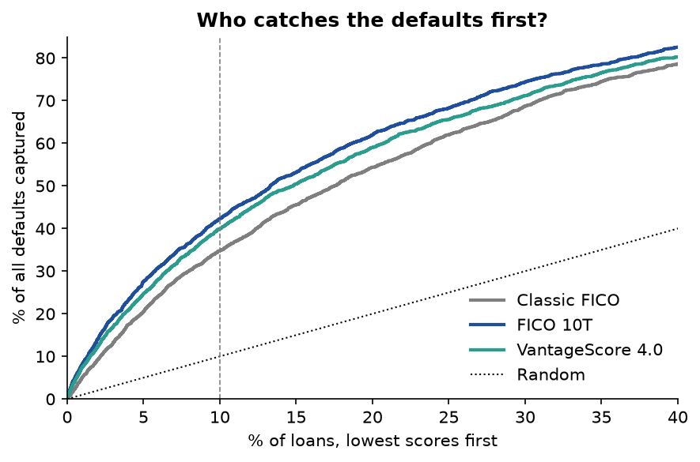
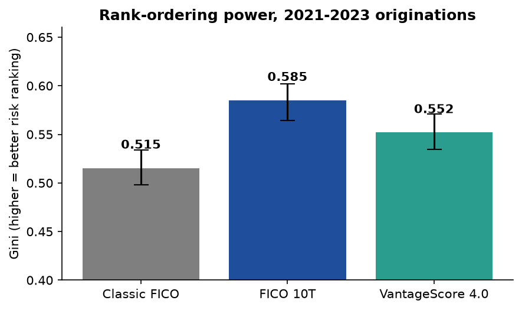
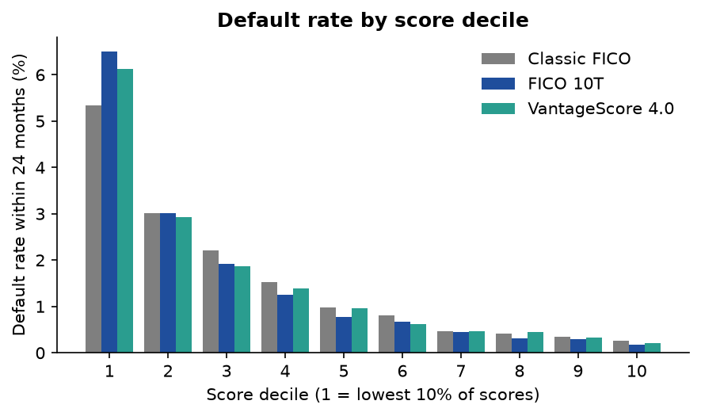
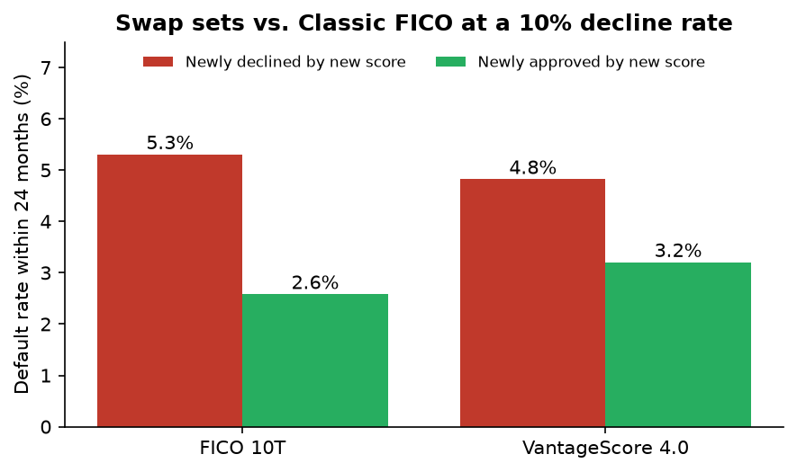
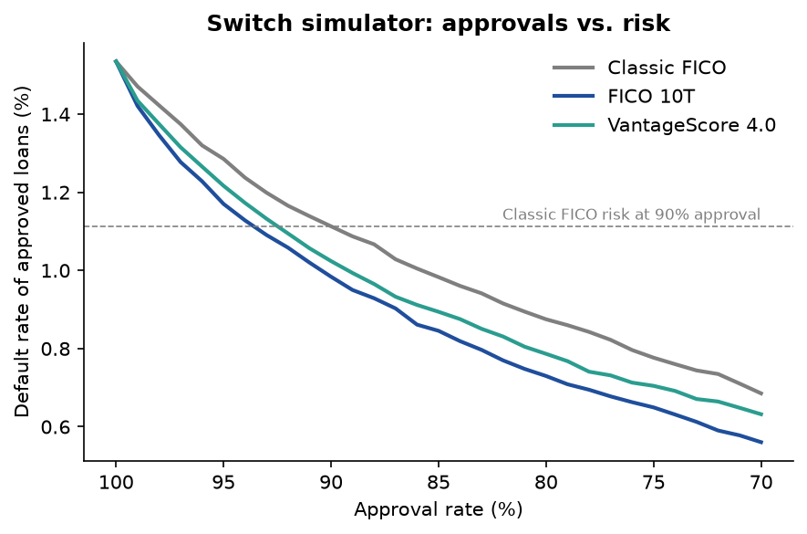
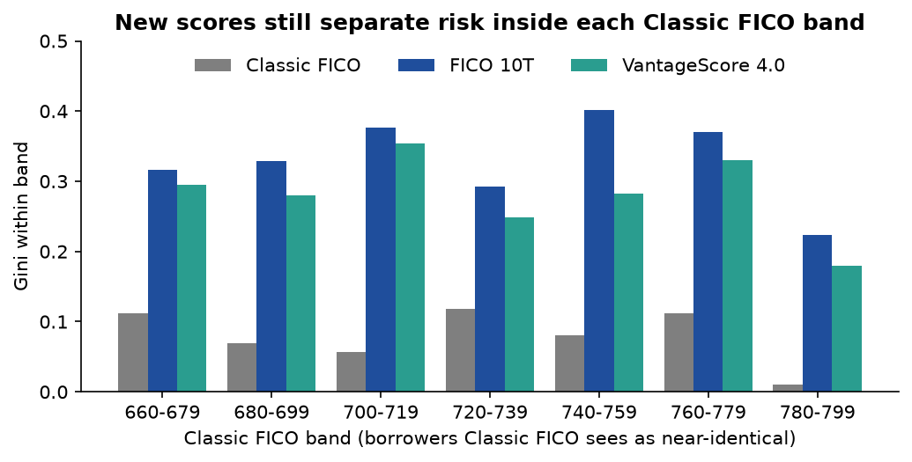

# Switching Credit Scores: What Changes When Mortgage Lending Moves Beyond Classic FICO

**Classic FICO vs. FICO 10T vs. VantageScore 4.0 on 425,000 Freddie Mac mortgages**

*Author: Iman Fatima · Python, SQL (DuckDB), scikit-learn, matplotlib*

---

## TL;DR

On mortgages originated 2021–2023, **FICO 10T ranks default risk clearly better than Classic FICO,
and VantageScore 4.0 sits in between.** At the same default rate as a Classic FICO policy that
declines 10% of applicants, **FICO 10T could approve 350 more borrowers per 10,000**
(VantageScore 4.0: 260 more). The gain is largest where decisions are hardest: borrowers below 700.

| Score | Gini (95% CI) | KS | Defaults caught in lowest-scored 10% |
| --- | --- | --- | --- |
| Classic FICO | 0.515 (0.498–0.534) | 0.403 | 34.7% |
| VantageScore 4.0 | 0.552 (0.535–0.571) | 0.424 | 40.0% |
| **FICO 10T** | **0.585 (0.565–0.602)** | **0.451** | **42.3%** |

<p align="center"></p>

---

## 1. Background: why this question matters now

Mortgages sold to Freddie Mac and Fannie Mae have been underwritten with **Classic FICO**, a
model built in the early 2000s, for roughly two decades. That is changing:

- The Federal Housing Finance Agency (FHFA) has approved two newer models for these mortgages:
  **FICO 10T**, which uses *trended* data (how balances and payments moved over the past
  ~24 months), and **VantageScore 4.0**.
- In 2026 Freddie Mac published **historical FICO 10T and VantageScore 4.0 scores** for loans
  it already owns, so lenders and investors can test the switch on real outcomes.
- FHFA is also weighing a move from three credit bureau reports ("tri-merge") to two ("bi-merge")
  to lower borrowers' closing costs.

Every lender, mortgage investor and credit-risk team now faces the same question: **if we switch
scores, who gets approved differently, and what happens to defaults?** The historical FICO 10T
file was first released in July 2026, so very little public analysis of it exists yet.

## 2. Business questions

1. Which score best separates borrowers who default from those who don't?
2. If a lender declines the same share of applicants, how many fewer defaults does each new score produce?
3. At the same risk level, how many *more* borrowers could each new score approve?
4. Which borrower segments gain the most?
5. Does dropping from three credit bureaus to two hurt risk ranking?
6. Do the findings survive the obvious objections (selection bias, data timing, outcome definition)?

## 3. Data

| Source | Contents | Used here |
| --- | --- | --- |
| [Freddie Mac Single-Family Loan-Level Dataset](https://www.freddiemac.com/research/datasets/sf-loanlevel-dataset), Release 48 (sample files) | Loan attributes at origination (Classic FICO, LTV, DTI, purpose, ...) + monthly payment history through June 2026 | 425,000 loans, 2018–2026 vintages |
| Freddie Mac historical FICO 10T file for SFLLD (published July 2026) | FICO 10T at origination, 5 bureau-merge methods | 381,722 matched loans |
| Freddie Mac historical VantageScore 4.0 files for SFLLD (July 2024 + July 2026 supplement) | VantageScore 4.0 at origination, 5 bureau-merge methods | 381,804 matched loans |

All three scores were matched for **99.8%+ of 2018–2024 loans**. The 2025 vintage is 64% covered
(score files end at Q3 2025) and 2026 is not covered.

**Raw data is not included in this repository.** The score files' terms prohibit redistributing
loan-level data, so only aggregated results are published here. See [Reproduce](#8-reproduce).

## 4. Method

- **Outcome ("default"):** 90+ days delinquent, or a credit-loss termination (short sale,
  third-party sale, REO, charge-off), within 24 months of the first payment.
- **Headline cohort:** 2021–2023 originations, 149,860 loans, 2,300 defaults. The 2018–2020
  vintages are reported separately because COVID payment forbearance distorted delinquency.
- **Like-for-like scores:** the main comparison uses each new score's "Current Method"
  (middle-of-three bureau scores, then lowest borrower), which is how Classic FICO is reported.
- **Metrics:** Gini and KS (rank-ordering power), share of defaults captured in the lowest
  10% / 20% of scores, paired bootstrap 95% confidence intervals (300 resamples), swap-set
  analysis, an approval-vs-risk switch simulator, and segment / within-band breakdowns.

Full definitions, field mappings and the data-quality audit are in
[`docs/methodology.md`](docs/methodology.md).

## 5. Findings

### 5.1 Both new scores rank risk better; FICO 10T leads

<p align="center"></p>

| Comparison | Gini lift vs. Classic FICO | 95% CI |
| --- | --- | --- |
| FICO 10T, 2021–2023 | **+7.0 pts** | +5.7 to +8.2 |
| VantageScore 4.0, 2021–2023 | **+3.7 pts** | +2.1 to +5.2 |
| FICO 10T, 2018–2020 (COVID-affected) | +3.5 pts | +2.5 to +4.5 |
| VantageScore 4.0, 2018–2020 (COVID-affected) | +1.0 pts | −0.0 to +2.1 (not significant) |

The lowest-scored 10% of borrowers default at 6.5% under FICO 10T vs. 5.3% under Classic
FICO, and the highest-scored 10% at 0.17% vs. 0.27%, so FICO 10T spreads risk further at both ends.

<p align="center"></p>

### 5.2 Swap sets: who changes places?

If a lender declines its lowest-scored 10% under each score, about 6,400 borrowers swap places
when moving from Classic FICO to FICO 10T:

<p align="center"></p>

The borrowers FICO 10T newly declines default at **5.3%**, about twice the **2.6%** rate of the
borrowers it newly approves. Net effect: **~12 fewer defaults per 10,000 loans at the same approval rate**
(VantageScore 4.0: ~8).

### 5.3 Switch simulator: more approvals at the same risk

<p align="center"></p>

| Classic FICO policy | Approved default rate | Extra approvals per 10k at the same risk: FICO 10T | Extra approvals per 10k: VantageScore 4.0 |
| --- | --- | --- | --- |
| Decline lowest 5% | 1.28% | +210 | +140 |
| Decline lowest 10% | 1.11% | +350 | +260 |
| Decline lowest 15% | 0.98% | +490 | +360 |
| Decline lowest 20% | 0.87% | +640 | +390 |

Holding approvals fixed instead (decline 10%), expected credit loss on the approved book falls from
**28.6 bps to 25.8 bps** with FICO 10T (−10%), assuming 25% loss severity.

### 5.4 Biggest gains in the hardest segments

| Segment | Default rate | Classic FICO Gini | FICO 10T Gini | VantageScore 4.0 Gini |
| --- | --- | --- | --- | --- |
| All loans | 1.5% | 0.515 | 0.585 | 0.552 |
| **Classic FICO < 700** | 4.5% | **0.188** | **0.368** | **0.321** |
| Cash-out refinance | 2.2% | 0.452 | 0.553 | 0.535 |
| Single borrower | 2.0% | 0.499 | 0.584 | 0.544 |
| DTI > 43% | 2.2% | 0.425 | 0.498 | 0.462 |
| LTV > 90% | 2.5% | 0.426 | 0.494 | 0.429 |
| First-time buyer | 1.8% | 0.508 | 0.570 | 0.522 |

Among sub-700 borrowers, FICO 10T nearly **doubles** Classic FICO's ranking power.

### 5.5 Two bureaus don't hurt

| Version | FICO 10T Gini | VantageScore 4.0 Gini |
| --- | --- | --- |
| Tri-merge, Current Method | 0.585 | 0.552 |
| Tri-merge, average then average | 0.618 | 0.581 |
| **Bi-merge, lowest pair** | **0.621** | **0.583** |

The proposed averaging method and the bi-merge (two-bureau) version both rank risk slightly
*better* than the current tri-merge method. On risk-ranking grounds alone, this data gives no
reason to keep the third bureau report.

## 6. Robustness: do the limitations undo the result?

**Selection effect.** Every loan here was approved using Classic FICO, which could make Classic
FICO look artificially weak. Filtering can shrink a score's own measured power, but it cannot put
new information into a *different* score. Two tests:

| Cross-validated logistic model | Gini |
| --- | --- |
| Classic FICO | 0.514 |
| FICO 10T | 0.584 |
| Classic FICO + FICO 10T | 0.586 |
| Classic FICO + LTV + DTI | 0.568 |
| Classic FICO + LTV + DTI + FICO 10T | **0.625** |

- Once FICO 10T is known, Classic FICO adds almost nothing (0.584 to 0.586). The reverse isn't true.
- FICO 10T still adds ~6 points after controlling for the down payment and debt-to-income
  factors underwriters used to approve lower-score borrowers.
- **Within 20-point Classic FICO bands**, where Classic FICO sees borrowers as near-identical
  (Gini 0.01–0.12), FICO 10T still separates defaulters (Gini 0.22–0.40):

<p align="center"></p>

**Archive timing.** The new scores were rebuilt from archived bureau data, not the lender's exact
credit pull. If that gave them an unfair edge, it would show up mostly in very early defaults. It doesn't:

| Outcome | Classic FICO | FICO 10T | VantageScore 4.0 |
| --- | --- | --- | --- |
| Default in months 1–12 | 0.511 | 0.591 | 0.564 |
| Default in months 13–24 | 0.519 | 0.580 | 0.542 |
| 60+ days delinquent within 24 months | 0.497 | 0.551 | 0.518 |

**What this study can and can't claim.** It shows that, among GSE-approved mortgages, FICO 10T
carries risk information Classic FICO misses. It can't estimate effects on *declined*
applicants (never observed), so it doesn't claim a market-wide default reduction.

## 7. Recommendations

1. **Lenders:** prioritize FICO 10T in score-transition pilots and model validation, starting
   with the sub-700 and cash-out refinance segments, where the lift is largest.
2. **Risk / pricing teams:** re-cut score-based cutoffs and pricing grids; a cutoff held at the
   same *number* will not deliver the same risk, because score distributions shift (median
   FICO 10T is ~6 points higher than Classic FICO).
3. **Policy:** the bi-merge results suggest two bureaus can be used without losing risk ranking.
4. **Next study:** repeat the comparison on a lender's full application file, including declined
   applicants (reject inference), to address the observed-loans-only limitation.

A one-page version for non-technical readers: [`docs/executive_memo.md`](docs/executive_memo.md).

## 8. Reproduce

1. Register (free) and download:
   - SFLLD **sample files** 2018–2026 from [Freddie Mac Clarity](https://www.freddiemac.com/research/datasets/sf-loanlevel-dataset).
   - From the Credit Score Models and Reports Initiative page (hosted on InvestorSet / Finsight):
     `FRE_FICO10T_SFLLD_Historical.zip`, `FRE_VS4_SFLLD_Historical.zip`,
     `FRE_VS4_2023-Q32025_SFLLD_Historical.zip`.
2. Unzip everything into `data/extract/`.
3. Run:

```bash
python -m venv .venv
.venv/bin/pip install -r requirements.txt
bash run_all.sh
```

`run_all.sh` builds the DuckDB database (~10 s), runs the data-quality audit, the comparison,
robustness checks and switch simulator, then regenerates every CSV in `outputs/` and chart in
`figures/` (~2 min on a laptop).

## 9. Repository structure

```
credit-score-transition/
├── README.md
├── run_all.sh                     one-command pipeline
├── requirements.txt
├── docs/
│   ├── executive_memo.md          one-page business summary
│   └── methodology.md             definitions, field layouts, data-quality audit
├── src/
│   ├── schema.py                  Freddie Mac file layouts (Release 47+)
│   ├── build_db.py                raw files -> DuckDB (orig, perf_loan, scores)
│   ├── audit.py                   data-quality / realism checks
│   ├── common.py                  shared cohort loading and metrics
│   ├── compare_scores.py          Gini, KS, capture, bootstrap CIs, swap sets, segments
│   ├── robustness.py              selection-effect, timing and outcome-definition tests
│   ├── switch_simulator.py        approval-rate vs. risk trade-off
│   ├── make_figures.py            charts
│   └── export_tableau.py          aggregated extract for a Tableau dashboard
├── outputs/                       aggregate result tables (CSV)
└── figures/                       charts used in this README
```

## 10. Data use

Source data © Freddie Mac. VantageScore 4.0 and FICO 10T historical scores were generated by
Equifax, Experian and TransUnion from archived credit data and are provided by Freddie Mac without
warranty. This repository contains only aggregated statistics; no loan-level records are
redistributed, and no attempt was made to identify individuals.
