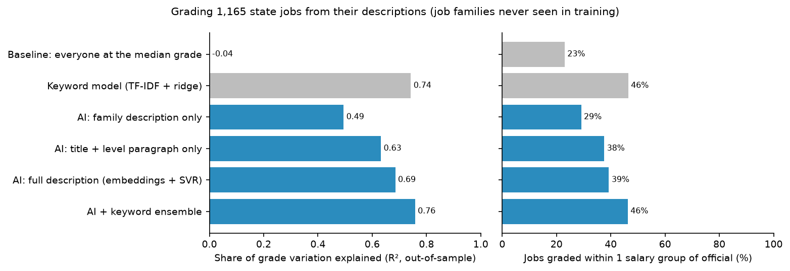
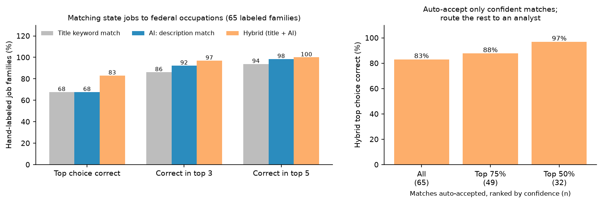
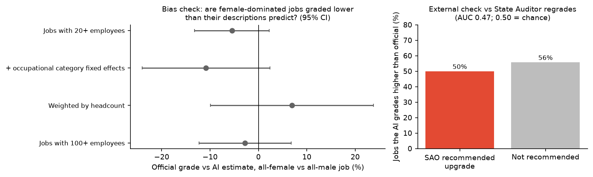

# Can AI help with job evaluation and market pricing? A test on 1,165 Texas state jobs

Total Rewards teams spend much of their time on two manual tasks: **grading jobs** (placing a role in
a salary group) and **market matching** (finding the survey benchmark that fits a role). This project
tests whether open-source AI tools can do either job well enough to be useful, using the State of
Texas classification plan as ground truth, because its job descriptions, grades, and pay data are all
public.

**Tools used:** a Hugging Face text-embedding model (BAAI `bge-base-en-v1.5`, run locally through
`sentence-transformers`), scikit-learn (support vector regression, TF-IDF, ridge regression),
`pypdf` for document parsing, DuckDB, and the U.S. Department of Labor's O\*NET 31.0 occupation
database. Everything is free and runs on a laptop CPU in about 4 minutes. No job data is sent to an
outside API.

## Key findings

**1. Market matching: AI is useful now, as long as an analyst checks it.**
Matching 386 state job families to federal occupations (the codes that BLS wage surveys use), a
hybrid of title keywords and AI description matching picked the right occupation first **83%** of
the time. The correct answer was in its top 3 suggestions **97%** of the time. Titles alone
reached 68%, and AI descriptions alone also reached 68%. Each one catches mistakes the other makes.

The hybrid also knows when it is unsure. When only its most confident half of matches is accepted
automatically, those matches are **97% correct**, and the other half goes to an analyst with three
ranked suggestions. That roughly halves the manual matching work without lowering accuracy.

**2. Job grading: AI cannot replace a job evaluator.**
Predicting each job's salary group from its description alone, for job families the model had never
seen:

| Method | Grade variation explained (R²) | Within 1 salary group | Within 2 groups |
|---|---|---|---|
| Everyone at the median grade (baseline) | 0.00 | 23% | 36% |
| Keyword model (TF-IDF + ridge) | 0.74 | 46% | 70% |
| AI: full description (embeddings + SVR) | 0.69 | 39% | 61% |
| AI + keyword ensemble | **0.76** | **46%** | **71%** |

The AI model on its own did *worse* than a simple keyword model. Combining the two gave the best
result, but it still placed fewer than half of jobs within one salary group of their official grade.
The tool's confidence signal barely helped: accepting only its most confident 60% raised accuracy
from 46% to 50%. At this accuracy, AI grading works as a first draft or a second opinion, and a
person still has to review every grade.

**3. The AI flags are leads, not findings.**
- **Review list:** 339 jobs where the AI grade differs from the official grade by 3 or more groups
  (200 where AI grades higher, 139 where it grades lower). The large ones are mostly direct-care and
  support roles, such as Psychiatric Nursing Assistant II (1,315 employees, AI estimate six groups
  higher) and Security Officer II (514 employees). The descriptions read like higher-graded work. That
  could reflect under-grading, or it could reflect the model reacting to words like "patients" and
  "security". Only a person reviewing the jobs can say which.
- **The flags do not match the State Auditor's regrades.** The State Auditor's October 2026 report
  (27-701) recommended moving 190 of these jobs to a higher salary group. The AI's "graded too low"
  signal does no better than chance at picking them out (AUC 0.47). That makes sense: the Auditor's
  recommendations come from market pay data, while the AI reads only job content. The two measure
  different things.
- **Gender check: no evidence either way.** Jobs held mostly by women are not graded significantly
  lower than their descriptions predict in any of four specifications. The estimates range from −11%
  to +7%, and every confidence interval includes zero.





## What this means for a Total Rewards team

- **Use AI for benchmark matching first.** It is accurate, it knows when to ask for help, and an
  analyst can check its work quickly because it shows three ranked suggestions.
- **Do not let AI set grades.** It is a useful second reader that can surface jobs worth another look.
  The final decision stays with a trained evaluator using a point-factor or leveling method.
- **Test before trusting.** The more sophisticated model was not the better one here. A simple keyword
  model beat the AI at grading, so every tool needs a baseline comparison on your own data.
- **Keep sensitive data local.** Open-source models run on your own hardware, so job and pay data
  never leave the organization.

## Limitations

- **Grading is learned from the official grades.** The model copies the State's existing structure.
  It can spot jobs that are inconsistent with the rest of the plan, but it cannot judge whether the
  plan itself is fair. That also limits the gender check: it can only find internal inconsistency.
- **Market-match labels are my own.** I hand-labeled the correct federal occupation for 65 job
  families (`labels/market_match_labels.csv`) so anyone can audit or change them. 65 is a small test
  set, so the accuracy figures carry roughly ±5 to 10 percentage points of uncertainty.
- **Level descriptions are thin.** Within a series, levels often differ only by boilerplate phrases
  such as "performs complex work" versus "performs highly complex work". About 5% of multi-level jobs
  have no level paragraph at all, mainly rank titles like Sergeant and Captain.
- **Grades encode more than job content.** Texas places some jobs higher for recruiting reasons, such
  as market pay or hard-to-fill roles. No description-based model can see those reasons.

## How to reproduce

```bash
python -m venv .venv && .venv/bin/pip install -r requirements.txt
./run_all.sh
```

`run_all.sh` downloads every source, parses the 386 job-description PDFs, embeds them, and rebuilds
every table and chart. A second run produced byte-identical outputs. Raw downloads go to `data/`,
which git ignores. See [`docs/methodology.md`](docs/methodology.md) for details.

| Script | What it does |
|---|---|
| `src/download.py` | Fetches the SAO job descriptions, salary schedule, Auditor report, O\*NET, and payroll |
| `src/parse_jobs.py` | Extracts description sections and level paragraphs, and removes salary information |
| `src/embed.py` | Turns job descriptions and O\*NET occupations into embeddings |
| `src/job_grading.py` | Grading models, cross-validation, and confidence routing |
| `src/grading_checks.py` | Review list, Auditor comparison, and gender check |
| `src/market_match.py` | Title, AI, and hybrid matching against O\*NET, plus confidence routing |
| `src/make_figures.py` | Charts |

## Data sources

- Texas State Auditor's Office: [job descriptions](https://hr.sao.texas.gov/CompensationSystem/JobDescriptions)
  and [report 27-701](https://sao.texas.gov/Reports/Main/27-701.pdf), the classification plan review
  for the 2028–29 biennium.
- Texas Comptroller: [FY 2026–27 salary schedules](https://fmx.cpa.texas.gov/fmx/payper/reascode/26-27/salsched_2026.php).
- [O\*NET 31.0 database](https://www.onetcenter.org/database.html), U.S. Department of Labor (CC BY 4.0).
- Texas state employee payroll, published by the Texas Tribune. Only headcount and gender share per
  job class are used. No individual records are published.
