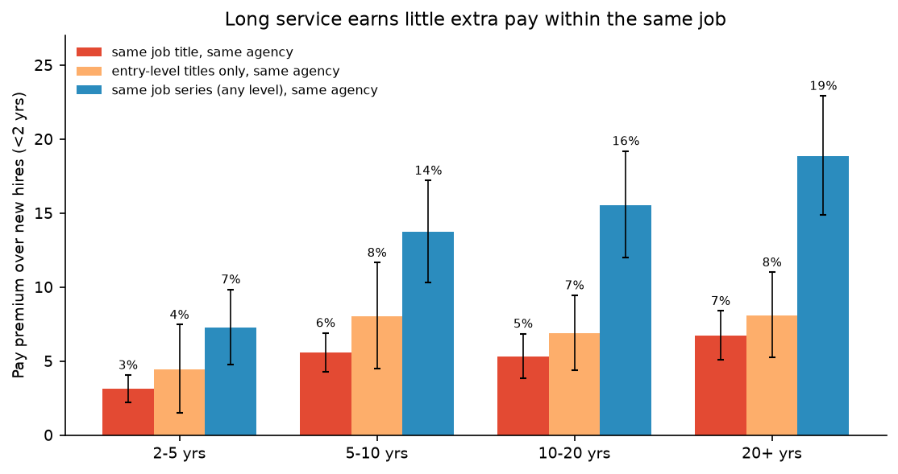
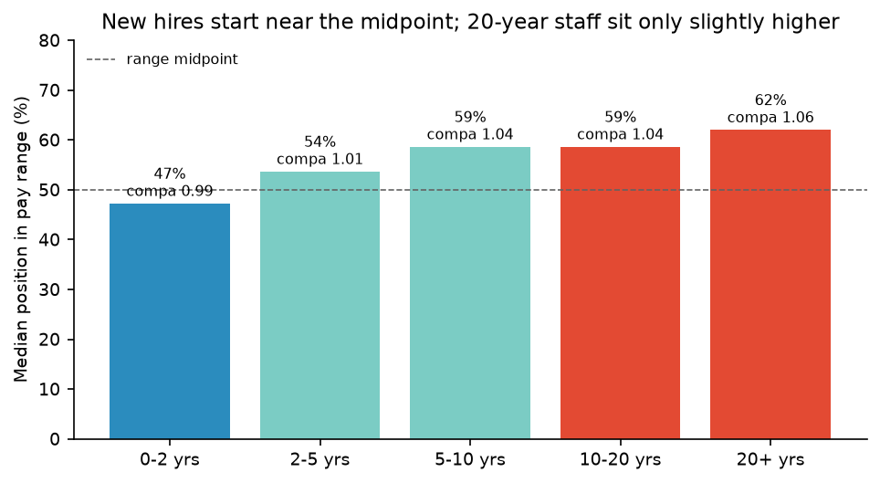
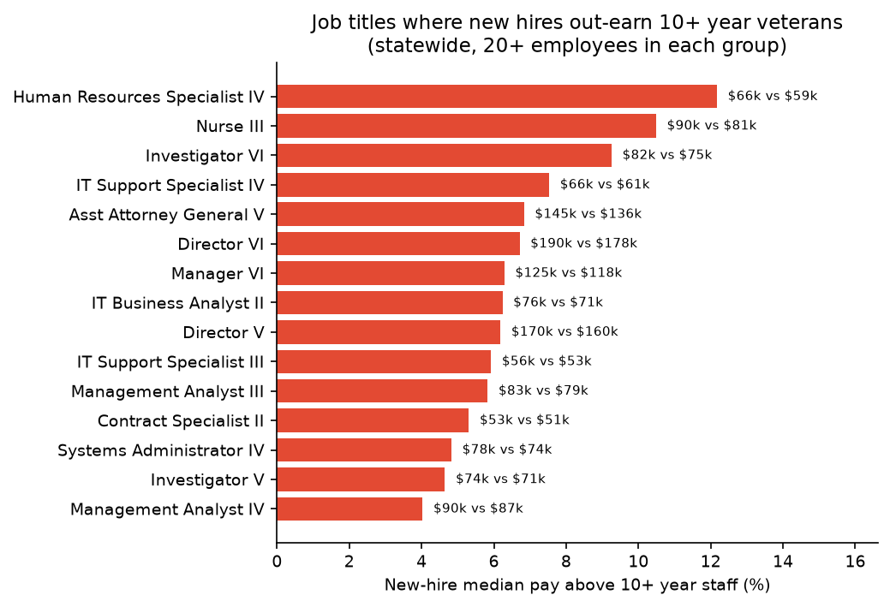
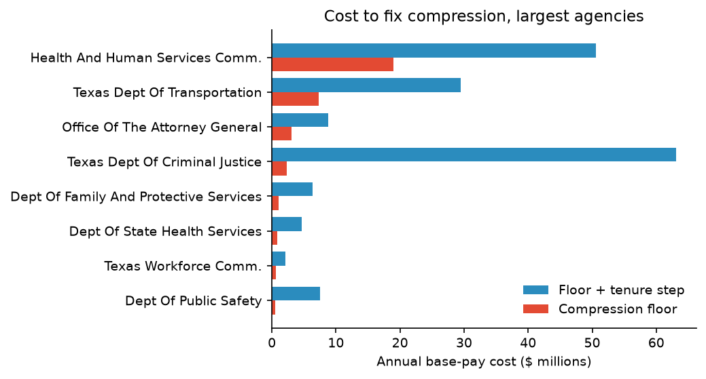
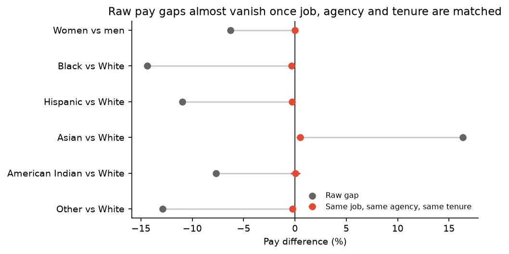
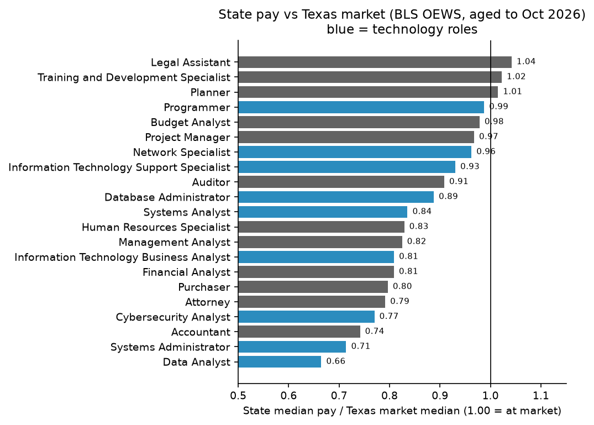

# Texas State Workforce Compensation Review

A consultant-style compensation review of **139,656 Texas state employees**
(103 agencies, 1,081 job titles, $9.36 billion in annual base pay), built on the
real October 2026 state payroll, the official FY2026–27 salary schedules, and
federal (BLS) market wage data.

It answers the four questions a compensation team is asked every budget cycle:

1. **Compression:** are long-serving employees paid more than new hires in the same job?
2. **Range position:** where do people sit inside their official pay ranges?
3. **Cost to fix:** what would it cost to correct compression?
4. **Pay equity and market:** are there unexplained gender or ethnicity gaps, and how does pay compare with the Texas market?

> Read the two-page [executive memo](docs/executive_memo.md) for the business
> summary, or [methodology](docs/methodology.md) for definitions, models and
> limitations.

---

## Headline findings

| Question | Finding |
|---|---|
| Compression | In the same job title at the same agency, staff with **10–20 years earn only 5.3% more than new hires**; 20+ years earns 6.7% more. |
| Inversion | In **41% of agency × job-title groups** (144 of 353), the new-hire median is **higher** than the 10+ year median. 69% are compressed (new hires at 95%+ of veteran pay). |
| Where growth happens | Pay rises 15–19% with tenure only when promotions (moving up a job series) are counted. Staying in a job is barely rewarded. |
| Range position | New hires sit at the **47th percentile** of their range; 20+ year staff at only the **62nd**. |
| Cost to fix | Lifting 6,420 tenured staff to the new-hire median costs **$35.3M a year (0.38% of payroll)**. A fuller fix that also pays 1% per year of service costs **$180.8M (1.9%)**. |
| Pay equity | Raw gaps are real (women −6.3%, Black −14.4%, Hispanic −11.0% vs White), but **within the same job, agency and tenure they shrink to under 0.5%**. The gap is about *which jobs* people hold, not unequal pay for the same job. |
| Agency flags | 3 of 28 large agencies show a statistically significant adjusted gender gap, all under 1% (Attorney General −1.0%, TCEQ −0.8%, Parks and Wildlife −0.5%). |
| Market | Across 21 professional benchmark jobs, state pay is **86% of the Texas market median**; technology roles are at **84%**. Systems administrators (0.71), accountants (0.74) and cybersecurity analysts (0.77) are furthest behind. |

---

## Charts

### 1. Long service earns little extra pay within the same job


Red bars compare people in the **same job title at the same agency**. Orange bars
repeat this for **entry-level titles only**, where nobody can have been promoted
in from below — the result holds, so it is not an artifact of promotions. Blue
bars compare across a whole job series (e.g. Accountant I–VII): that is where
pay growth actually happens.

### 2. Range position by tenure


### 3. Titles where new hires out-earn 10+ year veterans


Human Resources Specialist IV is the clearest case: new hires earn a median
$66,075 vs $58,904 for staff with 10+ years (+12%).

### 4. Cost to fix compression, by agency


### 5. Pay equity: raw vs adjusted gaps


### 6. State pay vs the Texas market


---

## Data

All sources are real, public and current. Raw files are **not** committed
(the payroll contains employee names); only aggregated outputs are published.

| Source | What it provides |
|---|---|
| [Texas Tribune Government Salaries Explorer](https://salaries.texastribune.org/) — payroll as of Oct 1, 2026, obtained from the Texas Comptroller under the Texas Public Information Act | Agency, job class, gender, ethnicity, employment type, hire date, annual salary for 154,795 employees |
| [Texas State Auditor's Office job classification index](https://hr.sao.texas.gov/CompensationSystem/JobDescriptions) | Official class code → salary group for all 1,246 classified job titles |
| [Texas Comptroller salary schedules, FY2026–27](https://fmx.cpa.texas.gov/fmx/payper/reascode/26-27/salsched_2026.php) | Min/max for every Schedule A and B salary group |
| [BLS Occupational Employment and Wage Statistics, May 2025](https://www.bls.gov/oes/) via the public BLS API | 25th/50th/75th percentile wages for Texas and the Austin metro area |

**Analysis population:** regular full-time classified employees on Salary
Schedules A and B (139,656 people). Excluded: part-time, temporary and
unclassified staff, 6,159 law-enforcement staff on Schedule C (step pay, no
min/max range), 45 rows flagged as multi-job records, and 3 records with
hire dates in the future. See [`outputs/data_quality_audit.txt`](outputs/data_quality_audit.txt).

---

## Methods in brief

- **Tenure premium:** log-salary regression on tenure bands with job-title ×
  agency fixed effects, standard errors clustered by job-title × agency.
- **Compression ratio:** new-hire (<2 yrs) median ÷ 10+ year median within
  each group; ≥0.95 = compressed, ≥1.00 = inverted.
- **Range penetration** = (salary − min) ÷ (max − min); **compa-ratio** =
  salary ÷ range midpoint.
- **Cost to fix:** raise eligible staff to the target, capped at range
  maximum; base pay only.
- **Pay equity:** four nested log-salary models (raw → + job title →
  + job title × agency → + tenure), clustered standard errors; per-agency
  models for the 28 agencies with 300+ employees and 50+ of each gender.
- **Market index:** state median ÷ BLS median aged to Oct 2026 at 3.5% a year;
  each state job series is mapped to one federal occupation code.

Full details: [docs/methodology.md](docs/methodology.md).

## Limitations

- **Hire date ≠ time in title.** The payroll records a hire date, not the date
  someone entered their current title. The entry-level-only check (chart 1)
  shows the compression result is not driven by this.
- **Base pay only.** No overtime, stipends, longevity pay or benefits.
- **No work location.** Market comparisons use statewide Texas wages, with
  Austin shown for reference.
- **Occupation matching is approximate.** For example, the state "Data
  Analyst" series is compared with the BLS "Data Scientists" code (which
  contains business-intelligence analysts), so its 0.66 index likely
  overstates the gap.
- **Adjusted gaps measure equal pay for equal jobs**, not equal access to
  higher-paid jobs. Near-zero adjusted gaps do not rule out differences in
  hiring or promotion.

---

## Repository layout

```
tx-comp-review/
├── run_all.sh              # rebuilds every output from data/raw/
├── src/
│   ├── common.py           # paths and shared settings
│   ├── fetch_market.py     # BLS OEWS via the BLS API (cached)
│   ├── build_db.py         # DuckDB build: payroll, job classes, salary ranges
│   ├── audit.py            # data-quality audit
│   ├── stats.py            # fixed-effects OLS with clustered standard errors
│   ├── compression.py      # tenure premium and compression ratios
│   ├── range_position.py   # range penetration and compa-ratios
│   ├── cost_to_fix.py      # remediation scenarios
│   ├── pay_equity.py       # adjusted gender and ethnicity gaps
│   ├── market.py           # market index vs BLS
│   ├── make_figures.py
│   └── export_tableau.py   # aggregated extract (groups of 5+ only)
├── outputs/                # aggregated CSVs + audit log
├── figures/
└── docs/
    ├── executive_memo.md
    └── methodology.md
```

## Reproduce

```bash
cd tx-comp-review
python3 -m venv .venv && .venv/bin/pip install -r requirements.txt
mkdir -p data/raw
curl -L -o data/raw/tx_payroll.csv \
  https://s3.amazonaws.com/raw.texastribune.org/state_of_texas/salaries/02_non_duplicated_employees/2026-10-01.csv
curl -L -o data/raw/sao_job_classes.html https://hr.sao.texas.gov/CompensationSystem/JobDescriptions
curl -L -o data/raw/salary_schedule_fy26_27.html \
  https://fmx.cpa.texas.gov/fmx/payper/reascode/26-27/salsched_2026.php
./run_all.sh
```

Outputs are deterministic: two consecutive runs produce byte-identical CSVs.

## Tools

Python (pandas, NumPy, DuckDB SQL, matplotlib), fixed-effects regression
written from scratch in NumPy, BLS public API.

## Author

Iman Fatima. Code under the MIT License; data belongs to its publishers.
